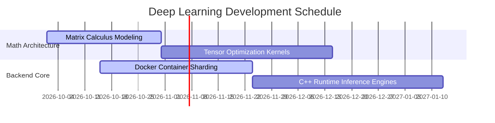

# ─── ⋆⋅⚔️ THE ANONYMOUS MACHINE LEARNING CITADEL ⚔️⋅⋆ ───

  
  

  

  
  
  

---

## 🌌 Core Thesis
I operate under the alias **C1PHER1111**. I am an anonymous researcher exploring the deeper mathematical boundaries of Neural Networks. 

* ⚔️ Like **Asta**, I accept the chaotic, heavy computational burdens of model training to shatter optimization limits.
* ☁️ Like **Gear 5 Luffy**, I visualize neural layers with complete freedom, rewriting algorithmic complexity into elegant vectors.

---

## ⚡ Core Engine (Tech Spectrum)

### 🧠 Deep Learning & Advanced Mathematics

  
  
  

### 💻 Low & High-Level Execution

  
  
  
  
  
  

### 🌐 System Layer & Backend Engineering

  
  
  
  

---

## 🧬 Research Codex (Math ⇛ Computer Science)

| Domain Dimension | Core Mathematics Framework | Computational Manifestation | Target State |
| :--- | :--- | :--- | :--- |
| **Deep Learning** | Linear Algebra, Multi-Variable Calculus | Stochastic Backpropagation & Tensors | `PyTorch` / `TensorFlow` |
| **High Performance** | Discrete Structures & Combinatorics | Thread-safe Memory Pools | `C++ Runtimes` / `Golang` |
| **Isolated Systems** | Graph Theory & Networking Topologies | Automated Containers & Secure Shells | `Docker` / `SSH` / `aaPanel` |
| **State Engines** | Asynchronous Event Calculi | Low-overhead Protocol Handlers | `Node.js` / `TS` / `JSON` |

---

## 🛠️ Machine Learning Operational Pipeline (Roadmap)

---

## 📊 Live Metrics Telemetry

  
  

### 🌌 Weekly Contributions Waveform

  

---

## 🏆 Vaulted Achievements (Trophy Room)

  

---

## 🐍 Grid Ecosystem (Contribution Snake)

  

---

## 📡 Encrypted Sub-Channels (Secure Communication Nodes)

  
  

---

## 🔮 Active Matrix Operations
- 🚀 **Optimising Tensors:** Offloading resource-heavy mathematical models directly to custom **C++** / **Golang** runtimes.
- 📡 **VPS Host Architecture:** Maintaining custom sandbox containers over secure **SSH** pathways behind hardened **aaPanel** firewalls.
- 🧬 **Stochastic Frameworks:** Evaluating backpropagation pathways using dense high-dimensional multi-variable calculus.

---

  

  <i>"Push past the structural limits. Reality is merely data waiting to be structured."</i>

Init premium anime profile readme
